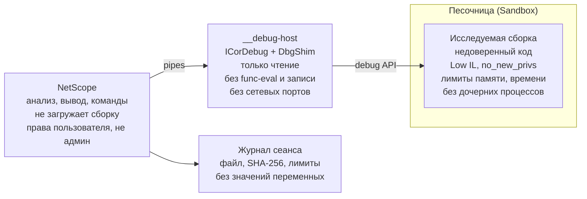

# ТЗ: NetScope 1.1 — доработки и отладчик

Дата: 2026-10-20 · Автор: Артемий Сарычев
https://github.com/rorythebreaker/netscope

## 1. Общие сведения

Версия 1.1 исправляет найденные ошибки, добавляет анализ безопасности и сравнение версий. Версия 1.2 добавляет отладчик. По умолчанию он работает только с процессами, которые запустил сам NetScope, в изоляции и с журналом действий.

| Версия | Состав |
| --- | --- |
| 1.1 | Исправления (раздел 2), PDB и перекрёстные ссылки (3), правила безопасности, SARIF и детектор обфускации (4), diff и dotnet tool (5) |
| 1.2 | Отладчик (разделы 6–8) |

**Не входит в работы:**

- обход антиотладочной защиты, скрытие отладчика от процесса, подмена или патчинг кода в памяти;
- внедрение кода и подключение к процессам других пользователей и системным процессам;
- деобфускация (только обнаружение и рекомендация внешнего инструмента);
- отладка .NET Framework 2.0–4.8 (только .NET Core 3.1 и новее);
- графический интерфейс.

Всё, что описано в ТЗ 1.0, сохраняется:

- консольный режим;
- коды возврата;
- чистый stdout;
- детерминированный вывод;
- запрет исполнения кода без `--allow-run`.

## 2. Исправления текущего кода

| № | Проблема | Где | Решение | Проверка |
| --- | --- | --- | --- | --- |
| 2.1 | Листинги JIT сопоставляются по ключу `Type:Method`, поэтому перегрузки могут перепутаться | `Native/JitRunner.cs`: `JitKey`, `ParseListings` | Хелпер печатает в stdout маркер `##NETSCOPE-TOKEN <токен>` перед каждым `PrepareMethod`. Листинг привязывается к последнему маркеру. Ключ по имени остаётся только как запасной вариант | Тест на классе с тремя перегрузками `Foo(int)`, `Foo(string)`, `Foo<T>(T)`: у каждой свой листинг, размеры кода различаются |
| 2.2 | После таймаута декомпиляции задача продолжает работать и занимает CPU | `Pseudo/PseudoGenerator.cs` | Счётчик брошенных задач на процесс. После 4 брошенных задач (ключ `--max-abandoned`) все оставшиеся методы сразу идут в упрощённый псевдокод, причина пишется в отчёт | Тест с искусственно медленным декомпилятором: число живых потоков не растёт выше лимита |
| 2.3 | `__jit-helper` изолирован только отдельным процессом и таймаутом | `Native/JitRunner.cs` | Общий модуль `Sandbox` (п. 7.3): Job Object на Windows, `setrlimit` и `prctl` на Linux. Лимит памяти задаётся `--run-memory` (по умолчанию 1 ГБ), дочерние процессы запрещены | Тест: сборка, которая в инициализаторе модуля запускает `cmd`/`sh` и выделяет 4 ГБ, завершается с понятной ошибкой, дочерний процесс не появляется |
| 2.4 | Сборка linux-arm64 не запускается в CI | `.github/workflows/ci.yml` | Раннеры `ubuntu-24.04-arm` и `windows-11-arm` для тестов и smoke-теста | Все четыре платформы зелёные |
| 2.5 | Предупреждения компилятора не ломают сборку | `Directory.Build.props` | `TreatWarningsAsErrors=true`, `AnalysisLevel=latest-recommended`, `EnforceCodeStyleInBuild=true` | Сборка проходит без предупреждений |

## 3. PDB и перекрёстные ссылки

### 3.1. Символы отладки (PDB)

- Символы ищутся в таком порядке:
  1. PDB, встроенный в сборку (embedded);
  2. файл `.pdb` рядом со сборкой;
  3. каталоги из `--pdb-path`.
- Поддерживается только Portable PDB. Для Windows PDB выводится предупреждение. Загрузка из сети и с серверов символов не выполняется.
- PDB принимается, только если его ID совпадает с записью CodeView в сборке. Иначе выводится предупреждение и символы не используются.
- Что даёт PDB:
  - в IL-листинге строки вида `// Program.cs:42` перед первой инструкцией каждой sequence point;
  - в CFG диапазон строк исходника для каждого блока;
  - в псевдокоде настоящие имена локальных переменных;
  - в JSON поля `source.file` и `source.line` у инструкций и блоков.
- Ключ `--no-pdb` отключает чтение символов.
- Ключ `--source` выводит строки исходника рядом с IL. Файл ищется по пути из PDB или в `--source-path`.

### 3.2. Перекрёстные ссылки

| Ключ | Что ищет | Вывод |
| --- | --- | --- |
| `--uses <маска>` | Методы, которые вызывают метод или тип по маске, например `System.Diagnostics.Process::Start*` | Вызывающий метод, смещение IL, строка исходника (если есть PDB) |
| `--find-string <текст>` | Строковые литералы (`ldstr`) с подстрокой или по маске. `--regex` включает регулярные выражения | Метод, смещение, сам литерал (длинные обрезаются до 200 символов) |
| `--fields` | Для каждого метода: какие поля он читает (`ldfld`, `ldsfld`, `ldflda`) и какие пишет (`stfld`, `stsfld`) | Группа `[Fields]` в отчёте |
| `--field-refs <маска>` | Кто читает и пишет поле по маске | Список методов с видом доступа |
| `--strings` | Все строковые литералы сборки | Таблица: строка и где она встречается |

Ключи `--uses`, `--find-string` и `--field-refs` работают как фильтры: они выбирают методы, к которым затем применяются остальные группы вывода. Поиск идёт по всем файлам группы.

## 4. Правила безопасности, SARIF, обфускация

### 4.1. Правила

Ключ `--audit` проверяет методы по набору правил и выводит находки с уровнем error, warning или note. Правила только читают IL и метаданные, код не исполняется.

| ID | Что находит | Уровень |
| --- | --- | --- |
| NS001 | Запуск процессов: `Process.Start`, `ProcessStartInfo` | warning |
| NS002 | Динамическая загрузка кода: `Assembly.Load*`, `AppDomain.Load`, `Activator.CreateInstance(string, …)` | warning |
| NS003 | Отражение по строковым именам: `Type.GetType(string)`, `GetMethod(string)` с последующим `Invoke` | note |
| NS004 | Небезопасная десериализация: `BinaryFormatter`, `NetDataContractSerializer`, `LosFormatter`, `SoapFormatter`, а также `TypeNameHandling`, не равный `None` | error |
| NS005 | Слабая криптография: MD5, SHA1, DES, 3DES, RC2, режим ECB, `new Random()` для токенов и паролей | warning |
| NS006 | Отключение проверки TLS: `ServerCertificateValidationCallback`, который возвращает `true` | error |
| NS007 | Захардкоженные секреты: строки подключения с `Password=`, ключи вида `AKIA…`, приватные ключи PEM | error |
| NS008 | Нативные вызовы: P/Invoke к `kernel32`, `advapi32`, `ntdll` (список функций задан в правиле), `Marshal.GetDelegateForFunctionPointer` | note |
| NS009 | SQL-запросы, собранные конкатенацией строк и переданные в `SqlCommand`, `OleDbCommand`, `NpgsqlCommand` | warning |
| NS010 | Запись в реестр (`Registry.*.SetValue`), автозагрузка, службы | note |

- Правила описаны в коде как классы с интерфейсом `IRule`. Новое правило добавляется одним файлом.
- `--rules NS001,NS004` выбирает правила, `--min-level warning` отсекает находки ниже указанного уровня.
- Подавление находок: атрибут `SuppressMessage` в сборке или файл `netscope.suppress` со строками вида `NS004 MyApp.Legacy.*`.
- С ключом `--fail-on error` при находках уровня error утилита возвращает код `4`. Без ключа коды возврата прежние.

### 4.2. SARIF

- `--format sarif` выдаёт SARIF 2.1.0: одно правило на каждый ID. Каждая находка содержит файл сборки, полное имя метода, смещение IL и строку исходника из PDB, если он есть.
- Файл проходит валидацию по схеме SARIF 2.1.0 и загружается в GitHub Code Scanning через `github/codeql-action/upload-sarif`.

### 4.3. Детектор обфускации

Ключ `--detect-obfuscation` выводит для сборки вердикт (нет, возможно, да), найденные признаки и имя обфускатора, если его удаётся распознать.

| Признак | Пример |
| --- | --- |
| Атрибуты обфускаторов | `ConfusedByAttribute`, `DotfuscatorAttribute`, `SmartAssembly.Attributes` |
| Нечитаемые имена | Больше 30% имён состоят из непечатаемых символов, Unicode-мусора или одного символа |
| Плоский CFG | Метод с одним `switch` на десятки веток внутри цикла (control flow flattening) |
| Шифрование строк | Почти нет `ldstr`, зато много вызовов одного статического метода с числом на входе |
| Повреждённые тела | Методы, тело которых не разбирается или ссылается на несуществующие токены |
| Прокси-вызовы | Много мелких методов-обёрток с одним `call` внутри |

Деобфускация не выполняется. При вердикте «да» выводится подсказка обработать файл внешним инструментом (de4dot) перед анализом.

## 5. Сравнение версий и распространение

### 5.1. Diff

Подкоманда `netscope diff <старая> <новая>` сравнивает две версии сборки. Можно передать два каталога, тогда файлы сопоставляются по имени сборки.

- Методы сопоставляются по полному имени и сигнатуре, а не по токену: токены меняются между сборками.
- Каждый метод получает статус: добавлен, удалён, изменён или без изменений.
- «Изменён» определяется по хешу IL, в котором токены заменены на полные имена. Поэтому перекомпиляция без изменений кода не даёт ложных отличий.
- Для изменённых методов выводятся:
  - разница IL в формате unified diff;
  - новые и пропавшие вызовы;
  - изменение сложности и числа блоков.
- Ключ `--pseudo` добавляет разницу псевдокода.
- Изменения типов, полей, атрибутов, ссылок на сборки и P/Invoke выводятся отдельным разделом.
- С `--audit` показываются только находки, появившиеся в новой версии.
- Форматы вывода: text и json.
- С ключом `--exit-code` утилита возвращает `0`, если различий нет, и `5`, если они есть (как `git diff`).

### 5.2. Распространение

- NuGet-пакет `NetScope.Tool` публикуется как `dotnet tool` (`dotnet tool install -g NetScope.Tool`). Публикация идёт из CI по тегу, если задан секрет `NUGET_API_KEY`.
- Манифест Scoop лежит в отдельном репозитории `rorythebreaker/scoop-bucket` и обновляется из CI по тегу.
- Релизные архивы сопровождаются файлом `SHA256SUMS.txt` и подписью GitHub Artifact Attestations (`actions/attest-build-provenance`). По ней можно проверить, что бинарник собран в CI из этого коммита.

## 6. Отладчик: функции и команды

Подкоманда `netscope debug` запускает исследуемую сборку как дочерний процесс и позволяет исполнять её пошагово. На каждой остановке показываются IL, блок CFG, псевдокод и нативный код. Это инструмент наблюдения: отладчик читает состояние процесса, но не меняет его код и данные.

**Запуск:**

```
netscope debug app.dll --allow-run [-- аргументы программы]
netscope debug app.dll --allow-run --script steps.txt --format json --out trace.json
```

- Поддерживаются сборки .NET Core 3.1 и .NET 5–10 (`dotnet app.dll` или apphost `app.exe`). Для .NET Framework выводится понятная ошибка.
- API: ICorDebug через пакеты ClrDebug и Microsoft.Diagnostics.DbgShim (`CreateProcessForLaunch`, `RegisterForRuntimeStartup`).
- Без `--allow-run` подкоманда не запускается и возвращает код `2` с объяснением.

**Команды (в интерактивном режиме и в файле `--script`):**

| Команда | Действие |
| --- | --- |
| `break <маска метода>[+IL_xxxx]` | Точка останова на входе в метод или на смещении IL. Маска такая же, как в `--filter` |
| `break <файл>:<строка>` | Точка останова по строке исходника (нужен PDB) |
| `delete <n>`, `breaks` | Удалить точку останова, показать список точек |
| `run`, `continue` | Запустить, продолжить до следующей остановки |
| `step`, `next`, `out` | Шаг с заходом, шаг без захода, выход из метода. При наличии PDB шаг идёт по строкам, иначе по инструкциям IL |
| `stepi` | Одна инструкция IL |
| `stack` | Стек вызовов с методами, смещениями IL и строками |
| `frame <n>` | Выбрать кадр стека |
| `args`, `locals` | Аргументы и локальные переменные выбранного кадра |
| `print <путь>` | Значение переменной или её поля, например `print user.Name`, `print items[3]`. Только чтение, без вызова методов и свойств-геттеров |
| `threads`, `thread <id>` | Список потоков, переключение на поток |
| `il`, `cfg`, `pseudo`, `asm` | Код текущего метода с отметкой текущей позиции |
| `exceptions on/off` | Останавливаться ли на первом выбросе исключения |
| `kill`, `quit` | Завершить процесс, выйти |

**Режимы:**

- **Интерактивный** (по умолчанию, если stdin — терминал): приглашение `(ns)`, история команд, автодополнение имён методов.
- **Скриптовый** (`--script`, или stdin — не терминал): команды выполняются по очереди, по окончании процесс завершается. Ввода утилита не ждёт, так что требование ТЗ 1.0 о работе без участия человека сохраняется.
- **События в JSON** (`--format json`): каждая остановка выводится объектом с причиной, потоком, стеком, переменными и текущим кодом. Такой вывод удобно разбирать скриптами.

**Ограничения значений:**

- строки обрезаются до 1000 символов;
- коллекции обрезаются до 100 элементов;
- глубина вложенности объектов ограничена 3 уровнями.

Все ограничения настраиваются ключами.

## 7. Отладчик: требования безопасности

Отладчик проектируется как инструмент только для чтения. Он работает с процессами, которые пользователь сам запустил через NetScope. Каждое требование ниже проверяется тестом (раздел 9).

### 7.1. Что разрешено и что запрещено

| Возможность | Решение | Почему |
| --- | --- | --- |
| Запуск сборки как дочернего процесса под отладкой | Разрешено с `--allow-run` | Основной сценарий |
| Чтение стека, переменных, полей, кода | Разрешено | Это наблюдение, процесс не меняется |
| Точки останова, шаги | Разрешено | Стандартные механизмы ICorDebug, код сборки на диске не меняется |
| Подключение к уже работающему процессу | Только с `--attach <pid>`, только к процессу того же пользователя и только если процесс запущен с переменной `NETSCOPE_DEBUG_ALLOW=1` | Нельзя подключиться к чужому или произвольному процессу |
| Подключение к процессам других пользователей, служб, SYSTEM, root | Запрещено, проверка выполняется до подключения | Защита от повышения привилегий и слежки |
| Запуск NetScope от администратора или root | Запрещено, NetScope выходит с ошибкой. Обойти можно только ключом `--i-know-running-as-admin`, это фиксируется в журнале с предупреждением | Отлаживаемый код получил бы те же права |
| Изменение значений переменных, `set`, `setip` | Не реализуется | Инструмент только наблюдает |
| Вызов методов и геттеров при `print` (func-eval) | Не реализуется | Func-eval исполняет произвольный код внутри процесса |
| Запись в память процесса, патчинг кода, внедрение DLL | Не реализуется | Вне назначения инструмента |
| Скрытие отладчика, обход антиотладки (`IsDebuggerPresent`, `Debugger.IsAttached` и т. п.) | Не реализуется | Процесс всегда может обнаружить, что его отлаживают |
| Отладка NativeAOT и нативного кода (ptrace, DbgEng) | Не реализуется | Вне .NET-сценария |

### 7.2. Явное согласие

- Без `--allow-run` подкоманда `debug` ничего не запускает.
- Перед первым запуском в интерактивном режиме выводится предупреждение: какой файл будет исполнен, с какими правами и какие ограничения изоляции включены. Пользователь подтверждает запуск вводом `y`.
- В скриптовом режиме подтверждением служит ключ `--allow-run`, а предупреждение уходит в stderr и в журнал.
- Перед запуском вычисляется SHA-256 файла, и хеш показывается пользователю. Если файл изменился между анализом и запуском, запуск отменяется.

### 7.3. Изоляция отлаживаемого процесса

Используется общий модуль `Sandbox`, тот же, что и для `__jit-helper` (п. 2.3).

| Ограничение | Windows | Linux | По умолчанию |
| --- | --- | --- | --- |
| Завершение вместе с NetScope | Job Object `KILL_ON_JOB_CLOSE` | `PR_SET_PDEATHSIG` | Всегда |
| Лимит памяти | Job Object `JOB_OBJECT_LIMIT_PROCESS_MEMORY` | `RLIMIT_AS` | 1 ГБ, ключ `--run-memory` |
| Лимит времени | Таймер NetScope | Таймер NetScope | 10 минут, ключ `--run-timeout` |
| Запрет дочерних процессов | Job Object `ACTIVE_PROCESS = 1` | Seccomp-фильтр на `fork`/`execve`, если он доступен; иначе `RLIMIT_NPROC` для отдельного пользователя | Включён, снимается ключом `--allow-child-processes` |
| Без сети | Средствами ОС без прав администратора не гарантируется: выводится предупреждение и рекомендация использовать VM | `unshare --net`, если доступны user namespaces | Включён там, где возможно |
| Пониженные права | Токен с Low Integrity Level, запись только во временный каталог | Отдельный рабочий каталог, `no_new_privs` | Включено |
| Рабочий каталог | Новый временный каталог, удаляется после завершения | То же | Всегда |
| Переменные окружения | Только явный список: `PATH`, `DOTNET_*` для запуска и переменные, заданные пользователем через `--env K=V` | То же | Всегда |

Если какое-то ограничение включить не удалось, NetScope сообщает, какое именно, и не запускает процесс без ключа `--relax-sandbox <имя>`. Запуск с ослабленными ограничениями фиксируется в журнале. Для неизвестных сборок документация явно рекомендует запуск в VM или контейнере.

### 7.4. Безопасность самого NetScope

- Отладчик работает в отдельном процессе-посреднике `__debug-host`, а не в основном процессе NetScope. Сбой или зависание отладочного API не затрагивает анализатор.
- Все значения из отлаживаемого процесса считаются недоверенными:
  - длина строк ограничена;
  - управляющие символы терминала (ESC-последовательности) экранируются перед выводом;
  - циклические ссылки обрываются по глубине.
- NetScope и посредник обмениваются данными по анонимным каналам (pipes), без сетевых портов. DAP-сервер и TCP-порты не открываются.
- Скрипт `--script` содержит только команды отладчика из таблицы раздела 6: без выражений на C# и без вызова внешних программ.

### 7.5. Журнал

- Каждый сеанс отладки пишет журнал в `%LOCALAPPDATA%\NetScope\logs` (Windows) или `~/.local/state/netscope/logs` (Linux). В журнал попадают:
  - время и пользователь;
  - путь и SHA-256 файла;
  - аргументы запуска;
  - включённые и ослабленные ограничения;
  - PID и код завершения.
- Ключ `--audit-log <путь>` пишет журнал в указанный файл, например в общую папку для администраторов.
- Содержимое переменных в журнал не пишется, только факт и место остановок. Так в журнал не попадут пароли и персональные данные.

## 8. Архитектура отладчика



NetScope никогда не загружает исследуемую сборку. С ней работает только посредник `__debug-host` через отладочный API, а сама сборка исполняется в песочнице.

- `DebugCommand` разбирает команды и формирует вывод. Для показа кода на остановке модули `MethodCatalog`, `CfgBuilder`, `PseudoGenerator` и `AsmProvider` используются как есть.
- `DebugHost` (процесс `__debug-host`) запускает сборку через DbgShim, держит ICorDebug и отвечает на запросы: стек, переменные, установка точек останова, шаги. Набор запросов закрыт, операций записи в протоколе нет.
- `Sandbox` применяет ограничения из п. 7.3 до старта исследуемого кода: процесс создаётся приостановленным, на него накладываются ограничения, и только затем он возобновляется.
- `AuditLog` пишет журнал сеанса из п. 7.5.
- Сопоставление позиции:
  - `ICorDebugILFrame.GetIP` даёт смещение IL, по нему находятся блок CFG и строка из PDB;
  - `ICorDebugNativeFrame.GetIP` вместе с Iced дают нативный код вокруг текущего адреса.

## 9. Этапы и критерии приёмки

Каждый этап — отдельная ветка и PR. PR сливается после зелёного CI на всех четырёх платформах и просмотра владельцем. Релиз выпускается тегом после слияния последнего этапа версии.

| Этап | Содержание | Релиз |
| --- | --- | --- |
| 1 | Исправления 2.1–2.5, модуль `Sandbox` | 1.1.0 |
| 2 | PDB, перекрёстные ссылки | 1.1.0 |
| 3 | Правила NS001–NS010, SARIF, детектор обфускации | 1.1.0 |
| 4 | `diff`, dotnet tool, Scoop, аттестация сборок | 1.1.0 |
| 5 | Отладчик: `__debug-host`, запуск в песочнице, остановка на входе в `Main`, `stack`, журнал | 1.2.0-preview |
| 6 | Точки останова, `continue`, `step`/`next`/`out`/`stepi`, `args`/`locals`/`print` | 1.2.0-preview |
| 7 | Связка с IL, CFG, псевдокодом и нативным кодом; `--script`, JSON-события | 1.2.0 |

**Критерии приёмки 1.1:**

- Тест на перегрузки из п. 2.1 проходит. Число брошенных задач декомпиляции не превышает лимит.
- Сборка с PDB показывает строки исходника и имена переменных. PDB с чужим ID отклоняется.
- `--uses` и `--find-string` находят все места в тестовой сборке; результат сверяется с эталоном в `Golden`.
- У каждого правила NS001–NS010 есть положительный и отрицательный пример в `NetScope.Samples`. SARIF проходит валидацию по схеме 2.1.0.
- Детектор обфускации даёт «да» для образцов, обработанных ConfuserEx, и «нет» для всех необфусцированных тестовых сборок.
- `diff` одной сборки, собранной дважды, даёт «без изменений». Изменение одного метода даёт ровно один изменённый метод.

**Критерии приёмки 1.2 (безопасность обязательна для каждого этапа отладчика):**

- Без `--allow-run` подкоманда `debug` не создаёт ни одного процесса. Проверяется расширением существующего теста с файлом-маркером.
- Попытка `--attach` отклоняется до вызова отладочного API в трёх случаях:
  - процесс другого пользователя;
  - процесс без переменной `NETSCOPE_DEBUG_ALLOW=1`;
  - системный процесс.
- Запуск NetScope от администратора или root без явного ключа завершается с кодом `2`.
- Тестовая сборка пытается запустить `cmd`/`sh`, выделить 4 ГБ, открыть сетевое соединение и записать файл вне временного каталога. Ни одна попытка не удаётся, и каждая видна как исключение в отлаживаемом процессе.
- После `kill` или аварийного завершения NetScope отлаживаемый процесс завершён, а временный каталог удалён.
- В протоколе между NetScope и `__debug-host` нет операций записи в память, изменения переменных и func-eval. Это проверяется тестом на перечень сообщений протокола.
- Строка с ESC-последовательностями в переменной отлаживаемого процесса выводится экранированной.
- Журнал сеанса содержит путь, SHA-256, ограничения и код завершения и не содержит значений переменных.
- Отладка тестовой сборки проходит в CI на Windows x64 и Linux x64. На ARM64 выполняется smoke-тест запуска и остановки на `Main`.
