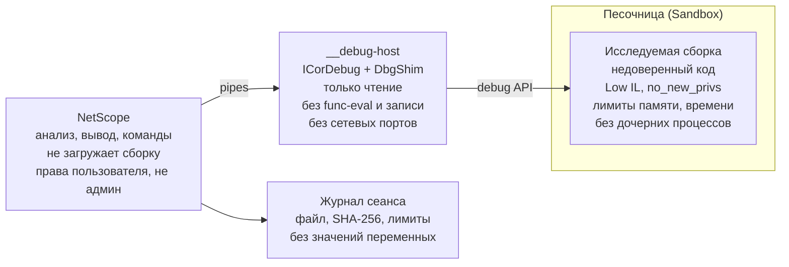

# ТЗ: NetScope — отладчик, отладка .NET Framework, мост для Ghidra, анализ по PE-заголовку

Дата: 2026-10-21 · Автор: Артемий Сарычев

## 1. Общие сведения

Документ описывает четыре доработки. Отладка .NET Framework (раздел 4) опирается на отладчик (раздел 3), остальные независимы.

| № | Доработка | Статус | Раздел |
| --- | --- | --- | --- |
| 1 | Отладчик .NET Core 3.1+ (только чтение, в песочнице) | новое | 3 |
| 2 | Отладка .NET Framework 2.0–4.8 | новое, поверх отладчика | 4 |
| 3 | Мост для Ghidra (экспорт аннотаций) | новое | 5 |
| 4 | Определение файлов по PE-заголовку, а не по расширению | уже реализовано, раздел закрепляет требования и крайние случаи | 6 |

Отладчик проектируется как инструмент только для чтения, работающий с процессами, которые пользователь сам запустил через NetScope. Намеренно не входят: патчинг памяти, внедрение кода, подключение к чужим и системным процессам, обход антиотладки, а также дизассемблирование нативного C/C++ (нативная часть закрывается мостом в Ghidra, раздел 5).

Сохраняется всё из базовых ТЗ: консольный режим, коды возврата, чистый stdout, детерминированный вывод, запрет исполнения кода без `--allow-run`.

## 2. Термины

| Термин | Значение |
| --- | --- |
| PE | Portable Executable — формат заголовка всех `.exe`/`.dll` под Windows |
| CLR-заголовок | COR20-директория в PE, признак управляемой (.NET) сборки |
| ICorDebug | Управляемый отладочный API .NET |
| func-eval | Вызов метода внутри отлаживаемого процесса из отладчика (исполнение произвольного кода) |
| R2R | ReadyToRun: нативный код, предкомпилированный в образ |
| RVA | Relative Virtual Address — смещение от базы загрузки образа |

## 3. Отладчик

### 3.1. Назначение и запуск

Подкоманда `netscope debug` запускает исследуемую сборку как дочерний процесс и позволяет исполнять её пошагово. На каждой остановке показываются IL, блок CFG, псевдокод и нативный код. Отладчик читает состояние процесса, но не меняет его код и данные.

```
netscope debug app.dll --allow-run [-- аргументы программы]
netscope debug app.dll --allow-run --script steps.txt --format json --out trace.json
```

- Поддерживаются сборки .NET Core 3.1 и .NET 5–10 (`dotnet app.dll` или apphost `app.exe`). Для .NET Framework — раздел 4.
- API: ICorDebug через ClrDebug и Microsoft.Diagnostics.DbgShim (`CreateProcessForLaunch`, `RegisterForRuntimeStartup`).
- Без `--allow-run` подкоманда не запускается и возвращает код `2` с объяснением.

### 3.2. Команды

| Команда | Действие |
| --- | --- |
| `break <маска метода>[+IL_xxxx]` | Точка останова на входе в метод или на смещении IL; маска как в `--filter` |
| `break <файл>:<строка>` | Точка останова по строке исходника (нужен PDB) |
| `delete <n>`, `breaks` | Удалить точку, список точек |
| `run`, `continue` | Запустить, продолжить до следующей остановки |
| `step`, `next`, `out` | Шаг с заходом, без захода, выход из метода (по строкам при PDB, иначе по IL) |
| `stepi` | Одна инструкция IL |
| `stack` | Стек вызовов с методами, смещениями IL и строками |
| `frame <n>` | Выбрать кадр стека |
| `args`, `locals` | Аргументы и локальные переменные выбранного кадра |
| `print <путь>` | Значение переменной или её поля. Только чтение, без вызова методов и геттеров |
| `threads`, `thread <id>` | Список потоков, переключение |
| `il`, `cfg`, `pseudo`, `asm` | Код текущего метода с отметкой текущей позиции |
| `exceptions on/off` | Останавливаться на первом выбросе исключения |
| `kill`, `quit` | Завершить процесс, выйти |

### 3.3. Режимы

- **Интерактивный** (по умолчанию, если stdin — терминал): приглашение `(ns)`, история команд, автодополнение имён методов.
- **Скриптовый** (`--script`, или stdin — не терминал): команды выполняются по очереди, по окончании процесс завершается. Ввода утилита не ждёт — требование о работе без участия человека сохраняется.
- **События в JSON** (`--format json`): каждая остановка — объект с причиной, потоком, стеком, переменными и текущим кодом.

Ограничения значений: строки до 1000 символов, коллекции до 100 элементов, глубина вложенности до 3; всё настраивается ключами.

### 3.4. Требования безопасности

#### 3.4.1. Что разрешено и что запрещено

| Возможность | Решение | Почему |
| --- | --- | --- |
| Запуск сборки как дочернего процесса под отладкой | Разрешено с `--allow-run` | Основной сценарий |
| Чтение стека, переменных, полей, кода | Разрешено | Наблюдение, процесс не меняется |
| Точки останова, шаги | Разрешено | Стандартные механизмы ICorDebug, код на диске не меняется |
| Подключение к работающему процессу | Только `--attach <pid>`, только к процессу того же пользователя с переменной `NETSCOPE_DEBUG_ALLOW=1` | Нельзя подключиться к чужому или произвольному процессу |
| Подключение к процессам других пользователей, служб, SYSTEM, root | Запрещено, проверка до подключения | Защита от повышения привилегий и слежки |
| Запуск NetScope от администратора или root | Запрещено, выход с ошибкой; обход только `--i-know-running-as-admin` с записью в журнал | Отлаживаемый код получил бы те же права |
| Изменение значений переменных, `set`, `setip` | Не реализуется | Инструмент только наблюдает |
| func-eval при `print` | Не реализуется | Исполняет произвольный код внутри процесса |
| Запись в память, патчинг кода, внедрение DLL | Не реализуется | Вне назначения инструмента |
| Обход антиотладки | Не реализуется | Процесс всегда может обнаружить отладку |

#### 3.4.2. Явное согласие

- Без `--allow-run` подкоманда `debug` ничего не запускает.
- Перед первым запуском в интерактивном режиме выводится предупреждение: какой файл, с какими правами, какие ограничения изоляции. Подтверждение вводом `y`. В скриптовом режиме подтверждением служит `--allow-run`, предупреждение уходит в stderr и журнал.
- Перед запуском вычисляется SHA-256 файла и показывается пользователю. Если файл изменился между анализом и запуском, запуск отменяется.

#### 3.4.3. Изоляция (модуль `Sandbox`, общий с JIT-хелпером)

| Ограничение | Windows | Linux | По умолчанию |
| --- | --- | --- | --- |
| Завершение вместе с NetScope | Job Object `KILL_ON_JOB_CLOSE` | `PR_SET_PDEATHSIG` | Всегда |
| Лимит памяти | Job Object `LIMIT_PROCESS_MEMORY` | `RLIMIT_AS` | 1 ГБ, `--run-memory` |
| Лимит времени | Таймер NetScope | Таймер NetScope | 10 минут, `--run-timeout` |
| Запрет дочерних процессов | Job Object `ACTIVE_PROCESS = 1` | seccomp на `fork`/`execve`, иначе `RLIMIT_NPROC` | Включён, снимает `--allow-child-processes` |
| Без сети | Без админ-прав не гарантируется: предупреждение, рекомендация VM | `unshare --net`, если доступны user namespaces | Включён где возможно |
| Пониженные права | Токен Low Integrity Level | `no_new_privs`, отдельный каталог | Включено |
| Рабочий каталог | Новый временный, удаляется после | То же | Всегда |
| Переменные окружения | Только явный список + `--env K=V` | То же | Всегда |

Если ограничение включить не удалось, NetScope сообщает какое и не запускает процесс без `--relax-sandbox <имя>`; ослабленный запуск фиксируется в журнале. Для неизвестных сборок документация рекомендует VM или контейнер.

#### 3.4.4. Безопасность самого NetScope

- Отладчик работает в отдельном процессе-посреднике `__debug-host`, а не в основном процессе: сбой отладочного API не затрагивает анализатор.
- Значения из отлаживаемого процесса недоверенные: длина строк ограничена, ESC-последовательности экранируются, циклические ссылки обрываются по глубине.
- Обмен NetScope ↔ посредник по анонимным каналам (pipes), без сетевых портов. DAP-сервер и TCP не открываются.
- `--script` содержит только команды из таблицы 3.2, без выражений на C# и внешних программ.

#### 3.4.5. Журнал

- Каждый сеанс пишет журнал в `%LOCALAPPDATA%\NetScope\logs` или `~/.local/state/netscope/logs`: время, пользователь, путь и SHA-256 файла, аргументы, включённые и ослабленные ограничения, PID, код завершения.
- `--audit-log <путь>` — журнал в указанный файл (например, общую папку для администраторов).
- Значения переменных в журнал не пишутся — только факт и место остановок, чтобы туда не попали пароли и персональные данные.

### 3.5. Архитектура



- `DebugCommand` разбирает команды и формирует вывод; для показа кода используются `MethodCatalog`, `CfgBuilder`, `PseudoGenerator`, `AsmProvider`.
- `DebugHost` (процесс `__debug-host`) запускает сборку через DbgShim, держит ICorDebug, отвечает на запросы. Набор запросов закрыт, операций записи в протоколе нет.
- `Sandbox` применяет ограничения 3.4.3 до старта: процесс создаётся приостановленным, ограничения накладываются, затем он возобновляется.
- `AuditLog` пишет журнал 3.4.5.
- Сопоставление позиции: `ICorDebugILFrame.GetIP` → смещение IL → блок CFG и строка PDB; `ICorDebugNativeFrame.GetIP` + Iced → нативный код вокруг адреса.

### 3.6. Критерии приёмки

- Без `--allow-run` подкоманда `debug` не создаёт ни одного процесса (тест с файлом-маркером).
- `--attach` отклоняется до вызова отладочного API для: процесса другого пользователя; процесса без `NETSCOPE_DEBUG_ALLOW=1`; системного процесса.
- Запуск от администратора/root без явного ключа завершается с кодом `2`.
- Тестовая сборка, пытающаяся запустить `cmd`/`sh`, выделить 4 ГБ, открыть сеть и записать файл вне временного каталога, не может сделать ничего из этого; каждая попытка видна как исключение в процессе.
- После `kill` или аварийного завершения NetScope процесс завершён, временный каталог удалён.
- В протоколе нет записи в память, изменения переменных и func-eval (тест на перечень сообщений).
- Строка с ESC-последовательностями выводится экранированной.
- Журнал содержит путь, SHA-256, ограничения, код завершения и не содержит значений переменных.

## 4. Отладка .NET Framework

### 4.1. Назначение

Отладчик из раздела 3 поддерживает только .NET Core 3.1+. Доработка добавляет второй бэкенд для .NET Framework 2.0–4.8. Команда `netscope debug` и набор команд не меняются.

### 4.2. Реализация

- Выбор бэкенда по образу: CLR 2.0/4.0 → Framework, иначе Core.
- API: `ICLRMetaHost` → `ICLRRuntimeInfo` → `ICorDebug` через `mscordbi` (у Core — `dbgshim`).
- Запуск только через `CreateProcess` с флагом отладки; процесс создаётся приостановленным, песочница применяется до возобновления.
- Слой сопоставления позиции (IL ↔ CFG ↔ PDB ↔ нативный код) переиспользуется из Core-бэкенда; различается только запуск и подключение.

### 4.3. Границы

- Модель безопасности не меняется: только чтение, только свои процессы, те же ключи и журнал.
- Изменение переменных и func-eval не реализуются.
- Только Windows: `mscordbi` — часть Windows-рантайма. На Linux для Framework-образа — понятная ошибка.
- Разрядность `__debug-host` выбирается под разрядность цели (x86/x64).

### 4.4. Критерии приёмки

- Отладчик останавливается на `Main` и показывает стек для тестовой сборки .NET Framework 4.8 на Windows.
- Точки останова, шаги, `args`/`locals`/`print` работают так же, как для Core.
- Те же тесты изоляции и запрета записи, что у Core-бэкенда, проходят для Framework.
- Framework-образ на Linux даёт понятную ошибку, а не падение.

## 5. Мост для Ghidra

### 5.1. Назначение

Нативную нагрузку за `P/Invoke`, методы C++/CLI и NativeAOT полноценно анализирует Ghidra. Экспорт строит мост: NetScope вычисляет адреса и имена, Ghidra получает их готовым скриптом и подписывает свои безымянные функции. Экспорт — чистый статический анализ, сборка не исполняется и не меняется, на выходе только текстовый скрипт.

### 5.2. Команда

```
netscope export-ghidra <файл> --out annotate.py [--lang python|java]
```

- `--out` обязателен.
- `--lang` — язык скрипта: `python` (Ghidrathon/Jython) или `java` (GhidraScript). По умолчанию `python`.
- Применимо к R2R, C++/CLI и NativeAOT. Для чистой IL-сборки без нативного кода — предупреждение, что аннотировать нечего.

### 5.3. Что содержит скрипт

| Аннотация | Источник в NetScope |
| --- | --- |
| Имя функции по адресу | RVA метода из R2R `RUNTIME_FUNCTION` и `InstanceMethodEntryPoints`; имя — полное имя .NET-метода |
| Комментарий с сигнатурой | Сигнатура метода из метаданных |
| Метки фанклетов | `; funclet N` из раздела нативного кода, с привязкой к родительскому методу |
| Имена импортов | IJW-таблицы импорта C++/CLI (`jmp [IAT]`-тунки) с именем целевой функции |
| Закладки | Точки интереса из `--audit` (P/Invoke, небезопасные вызовы) |

### 5.4. Требования

- Адреса — смещения от image base (из PE-заголовка), не абсолютные: Ghidra приводит их к своей базе.
- Скрипт идемпотентен: повторный запуск обновляет метки, а не плодит дубли.
- Скрипт содержит только вызовы Ghidra API для переименования, комментариев и закладок. Не обращается к сети, не читает посторонние файлы, не выполняет внешних команд. В шапке — перечень действий для чтения перед запуском.
- Имена и комментарии экранируются под синтаксис языка (в т. ч. Unicode из обфусцированных сборок).
- Версия Ghidra, на которой проверялось, указывается в шапке и документации.

### 5.5. Критерии приёмки

- На R2R-копии тестовой сборки после запуска скрипта (`analyzeHeadless ... -postScript`) число именованных функций совпадает с числом методов в `--native`.
- Адреса совпадают с RVA из `--native --format json`.
- В тексте скрипта нет обращений к сети и внешним командам (проверяется статически).

## 6. Определение файлов по PE-заголовку

### 6.1. Назначение

Раздел закрепляет уже реализованное поведение `AssemblyLoader` и описывает крайние случаи. Тип файла определяется по содержимому, а не по расширению: `.dll`/`.exe` — не гарантия управляемой сборки, а нужная сборка может иметь любое расширение.

### 6.2. Правила

1. Читается сигнатура `MZ` и переход к PE-заголовку (`PE\0\0`). Нет — файл не PE, пропускается.
2. Проверяется COR20-директория (CLR-заголовок). Нет — нативный PE, не управляемая сборка (см. 6.3).
3. Есть CLR-заголовок — файл принимается независимо от расширения (`.dll`, `.exe`, `.winmd`, без расширения).
4. Проверка не зависит от разрядности и платформы образа (PE32/PE32+).

### 6.3. Крайние случаи

| Случай | Поведение |
| --- | --- |
| Нативный PE (C/C++, нет CLR-заголовка) | Пропуск с пометкой «нативный PE»; при `export-ghidra` может быть целью для моста |
| `.dll`, но не PE (ресурс, переименованный архив) | Пропуск, причина в stderr |
| Управляемая сборка без расширения или с чужим (`.bin`, `.module`) | Принимается |
| Обрезанный или повреждённый PE | Пропуск с указанием, на каком заголовке разбор прервался |
| Смешанная сборка C++/CLI | Принимается: есть и CLR-заголовок, и нативный код |
| Пустой файл или каталог, попавший в маску | Пропуск без ошибки |

### 6.4. Критерии приёмки

- Управляемая сборка, переименованная в `.bin`, анализируется; нативная `kernel32.dll` пропускается с внятной причиной.
- Текстовый файл с расширением `.dll` даёт пропуск, а не падение.
- Код возврата `3` возвращается, только если ни один файл группы не оказался управляемой сборкой.
- Поведение детерминировано и покрыто тестами на каждый случай из таблицы 6.3.

## 7. Этапы

| Этап | Содержание | Зависимости |
| --- | --- | --- |
| 1 | PE-заголовок: тесты на крайние случаи 6.3, закрепление поведения | нет |
| 2 | Отладчик .NET Core: `__debug-host`, песочница, остановка на `Main`, `stack`, журнал | модуль `Sandbox` |
| 3 | Отладчик: точки останова, `continue`, шаги, `args`/`locals`/`print`, связка с IL/CFG/native, `--script`, JSON | этап 2 |
| 4 | Отладка .NET Framework: бэкенд `mscordbi` | этапы 2–3 |
| 5 | Мост для Ghidra: `export-ghidra`, python и java, идемпотентность | раздел нативного кода |

Каждый этап — отдельная ветка и PR, слияние после зелёного CI на всех платформах и просмотра владельцем. Безопасность (раздел 3.4) обязательна для каждого этапа отладчика.
